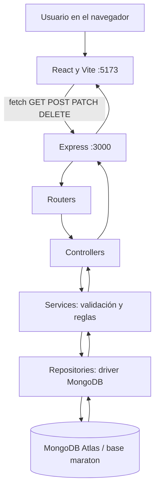
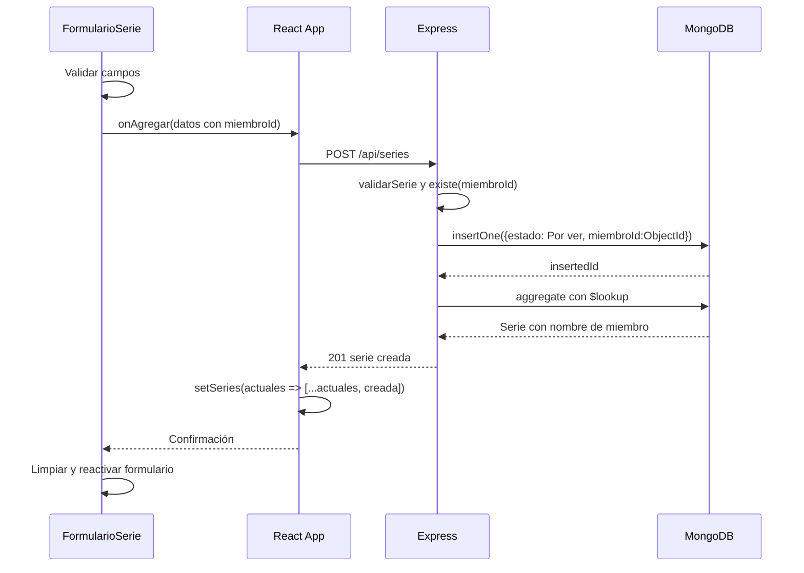
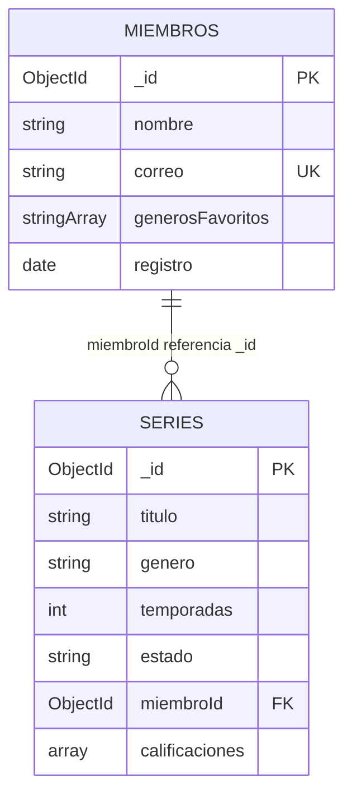

# Registro consolidado de laboratorios - Tarea 3

Este archivo reúne la documentación Markdown disponible localmente. No reemplaza ni modifica las fuentes originales.

> Nota: una sección solo aparece si su archivo fuente existe. Verifica que estén todos los laboratorios exigidos antes de entregar.

## Índice de fuentes incluidas

- `docs/laboratorios-adicionales.md`
- `docs/laboratorios-mongo-backend.md`
- `docs/maraton-series-backend/ARQUITECTURA.md`

---

## Documento: laboratorios-adicionales.md

# Anexo — Inventario de ejercicios complementarios de SOFT-12

Este documento complementa, **sin reemplazar**, las 20 secciones actuales de [`laboratorios.md`](laboratorios.md). Agrupa ejercicios realizados o preparados durante otras rondas de clase. **La evidencia de un archivo disponible como ZIP/PDF no confirma que ya se haya integrado, ejecutado o publicado en el repositorio.** Donde no existe evidencia real, se indica.

## A. Fundamentos web: HTML, CSS, Bootstrap y Sass

| Actividad | Trabajo realizado | Ubicación sugerida | Evidencia de ejecución |
|---|---|---|---|
| Semana 1 · Preparación del repositorio | Estructura inicial y normas Git | `actividades-clase/semana-1/preparacion-repositorio/` | Revisar repositorio local antes de atribuir una captura |
| Semana 1 · Maquetación semántica | Catálogo de iniciativas, estructura HTML y tarjetas | `actividades-clase/semana-1/maquetacion-semantica/` | PDF/código preparados; ejecución local por verificar |
| Semana 1 · Modelado y wireframe | Modelo conceptual, diseño de pantallas y semántica | `actividades-clase/semana-1/actividad-1-modelado/` | Documento de análisis, no captura de runtime |
| Semana 1 · Layout responsive | Flexbox, Grid y media queries | `actividades-clase/semana-1/actividad-2-layout/` | Verificar en distintos anchos de navegador |
| Semana 2 · Diagnóstico de estilos | Enlace CSS y corrección de reglas | `actividades-clase/semana-2/actividad-diagnostico-css/` | Comparar antes y después; captura pendiente |
| Cascada, especificidad y herencia | Cálculo de selectores, pseudoclases y refactor sin `!important` | `actividades-clase/semana-1/practica-cascada-especificidad-herencia/` | Comprobaciones DOM realizadas durante la práctica; DevTools en equipo pendiente |
| Bootstrap 01 · Primeros pasos | Contenedores, filas, columnas, componentes | `actividades-clase/bootstrap/01_primeros_pasos/` | Código/PDF preparados |
| Bootstrap 02 · Vivero La Semilla | Migración responsiva y navegación | `actividades-clase/bootstrap/02_vivero_la_semilla/` | Código de solución provisto por la guía |
| Bootstrap 03 · Clínica Huellitas | Formularios y componentes de Bootstrap | `actividades-clase/bootstrap/03_clinica_huellitas/` | Código de solución provisto por la guía |
| Bootstrap 04 · Gestor Académico | Componentes y tarjetas personalizadas | `actividades-clase/bootstrap/04_componentes_personalizados_gestor/` | Código/PDF preparados |
| Bootstrap 05 · Variables y temas | Cambio de tema con CSS/JS y persistencia | `actividades-clase/bootstrap/05_variables_y_temas/` | Prueba visual local pendiente |
| Sass 06 · Mixins | `@mixin`, `@include`, CSS compilado y explicación | `actividades-clase/sass/06_investigacion_sass_mixins/` | Investigación; no requiere demostrar backend |

**Recorrido técnico común:** la estructura semántica HTML describe el contenido; CSS define presentación y adaptabilidad; Bootstrap ofrece clases/utilidades; Sass agrega preprocesamiento; los cambios de estado visual pueden usar clases y custom properties. La cascada resuelve conflictos por origen, importancia, especificidad y orden.

**Reflexión:** aplicar únicamente más especificidad o `!important` dificulta el mantenimiento. Conviene identificar la regla ganadora en DevTools y estructurar los selectores alrededor de componentes y estados.

## B. React introductorio y ejercicios de migración

| Actividad | Resultado y alcance | Destino recomendado | Estado de evidencia |
|---|---|---|---|
| Pura Vida Tours HTML → React | Proyecto turístico con componentes, tours, reservas, testimonios y contacto | `proyectos-base/pura-vida-html/` y `proyectos-base/pura-vida-react/` existentes; no crear duplicados sin comparar | Evidencia original `docs/capturas/base_02_pura_vida_componentes.png` |
| Registro de solicitudes HTML/JS → React | Dos páginas, filtro localStorage en JS y componentes React de presentación | `proyectos-base/registro-solicitudes/` (si se decide integrar) | ZIP y PDF preparados; no figura en el repositorio remoto verificado |
| Laboratorio Conceptos React | Nueve temas: props, children, map/key, condicional, eventos, useState, inmutabilidad y estados elevado/derivado | `proyectos-base/conceptos-react/` como complemento (evitar duplicar `conceptos-interactivos/`) | Construcción del proyecto preparada; build local de ese complemento pendiente |
| Investigación por seis grupos | Props/children, listas/condicional, eventos, useState, inmutabilidad y estado compartido | Dentro de `conceptos-react/src/investigacion/` | Se prepararon ejercicios y presentaciones; exposición grupal no acreditada |

**Explique el recorrido (migración React):** `index.html` aporta el nodo `root`; `main.jsx` inicia React; `App.jsx` organiza componentes; las props llevan datos hacia hijos; los eventos solicitan cambios; `useState` conserva valores entre renderizados. Reusar componentes evita duplicar estructura en páginas similares.

**Reflexiona:** actualizar una variable ordinaria no solicita un render; React renderiza al cambiar el estado. Las listas necesitan claves estables. La interfaz React de Registro de solicitudes se definió como ejercicio visual; no se le deben atribuir altas o filtros funcionales que la consigna pospuso.

## C. APIs y consumo desde JavaScript

| Actividad | Requisito | Ruta sugerida | Evidencia |
|---|---|---|---|
| Descubriendo las APIs | Conceptos de request, response, endpoint, restaurante y exploración de la API asignada | `actividades-clase/apis/` | Investigación preparada; HTTP real por grupo pendiente |
| Maratón `series-js` | Buscador TVmaze por `fetch`, estados de carga/error/vacío, tarjetas DOM y POST simulado JSONPlaceholder | `maraton-series/series-js/` | Código y PDF preparados; **no aparece todavía en el GitHub consultado** |

**Explique el recorrido (fetch):** envío del formulario → función `async` → `fetch(URL)` → comprobación de `response.ok` → conversión `response.json()` → render de los resultados con nodos DOM. Un POST simulado de JSONPlaceholder devuelve una respuesta de prueba: no demuestra persistencia en una base de datos propia.

**Reflexiona:** una respuesta HTTP de error no necesariamente rechaza la promesa de `fetch`: por eso se comprueba `response.ok`. Los resultados de búsqueda y los errores se comunican sin recargar la página. Para evidenciar el laboratorio se necesitan capturas reales de lista, búsqueda vacía y manejo de error.

## D. MongoDB: prácticas de datos antes del backend

| Actividad | Objetivo | Carpeta sugerida | Evidencia |
|---|---|---|---|
| Instalación Atlas / extensión VS Code | Clúster, usuario, acceso de red y conexión | `maraton-series/mongo-practicas/` | Capturas históricas de Atlas y registros en `docs/capturas/` |
| Colección `miembros` | Crear/leer/actualizar/eliminar, correo único y géneros embebidos | `maraton-series/mongo-practicas/01-miembros.mongodb.js` | Resultado acumulativo de Atlas; no afirmar ejecución independiente del Playground |
| Colección `series` | Insert, find, filtros, conteos, update y delete | `maraton-series/mongo-practicas/01-series.mongodb.js` | Ejercicio previo al diseño referencial; no reutilizar IDs enteros en el backend final |
| Preparación del modelo del API | `ObjectId`, `miembroId`, índices y validación de esquema | `maraton-series/mongo-practicas/03-preparar-modelo-api.mongodb.js` | Servidor final actual maneja referencia MongoDB; Playground no estaba publicado al revisar |

**Distinción de modelos:** los primeros Playgrounds de clase emplean referencias en texto o IDs numéricos para familiarizarse con las operaciones. La versión final del API almacena `miembroId: ObjectId`; el `$lookup` necesita que el tipo de la referencia coincida con `_id` de la colección `miembros`.

## E. SQL Server: Subastas (práctica independiente)

- **Archivos preparados:** `01-crear.sql`, `02-datos.sql`, `03-pruebas.sql` y su README en `actividades-clase/sql-subastas/`.
- **Modelo:** `Coleccionistas`, `Categorias`, `Articulos`, `ArticuloCategorias`, `ArticuloFotos`, `Subastas` y `Pujas`; sus PK/FK y reglas aplican el paso de documentos a tablas.
- **Ejecución prevista:** instalar SQL Server Express y extensión `mssql` de VS Code; ejecutar los scripts en el orden anterior, usar una base `Subastas` de pruebas y consultar los resultados.
- **Advertencia crítica:** `01-crear.sql` elimina una base llamada `Subastas` si ya existe. No ejecutarlo sobre datos importantes.
- **Evidencia pendiente:** los scripts fueron revisados estructuralmente, pero **no consta su ejecución en una instancia real de SQL Server en esta ronda**. No sustituir esta prueba por imágenes generadas.

**Reflexiona:** una colección embebida o con referencias no se traslada mecánicamente a una sola tabla: los arrays se normalizan en tablas hijas/intermedias y las referencias se convierten en FK. El diseño de Subastas sirve de ejemplo para la Parte B de Innovation Hub, pero **no se debe mezclar su base con `Maraton`**.

## F. Comprobación de presencia y honestidad de las evidencias

La rama `main` consultada contiene `proyectos-base/{mi-primera-app,pura-vida-html,pura-vida-react,conceptos-interactivos}` y `maraton-series/{cliente,servidor,servidor-net}`. No incluye actualmente `actividades-clase/`, `series-js/` ni `mongo-practicas/`. Este anexo clasifica materiales **preparados**; no dice que estén ya copiados o ejecutados. Para incorporarlos: copiar las carpetas correspondientes, revisar conflictos y ejecutar sus pruebas reales. Las 31 capturas verificadas del proyecto entregado están catalogadas en `docs/capturas/README.md`.

---

## Documento: laboratorios-mongo-backend.md

# Laboratorios MongoDB, Express y React - SOFT-12

Estos doce laboratorios continúan los siete PDF del Maratón de series y culminan la conexión entre React, Express y MongoDB Atlas.

| Orden | Laboratorio | PDF |
|---|---|---|
| 1 | MongoDB Atlas y VS Code | [PDF](maraton-series-backend/01_MongoDB_Atlas_Instalacion_COMPLETADO.pdf) |
| 2 | Colección miembros | [PDF](maraton-series-backend/02_MongoDB_Coleccion_Miembros_COMPLETADO.pdf) |
| 3 | Colección series - modelo de práctica | [PDF](maraton-series-backend/03_MongoDB_Coleccion_Series_COMPLETADO.pdf) |
| 4 | API etapa 1 - estructura | [PDF](maraton-series-backend/04_API_Estructura_Proyecto_COMPLETADO.pdf) |
| 5 | API etapa 2 - escucha | [PDF](maraton-series-backend/05_API_Escuchando_COMPLETADO.pdf) |
| 6 | API etapa 3 - conexión MongoDB | [PDF](maraton-series-backend/06_API_Conexion_MongoDB_COMPLETADO.pdf) |
| 7 | API etapa 4 - módulo miembros | [PDF](maraton-series-backend/07_API_Modulo_Miembros_COMPLETADO.pdf) |
| 8 | API etapa 5 - listar y crear | [PDF](maraton-series-backend/08_API_Series_GET_POST_COMPLETADO.pdf) |
| 9 | API etapa 6 - estado y eliminar | [PDF](maraton-series-backend/09_API_Series_PATCH_DELETE_COMPLETADO.pdf) |
| 10 | React etapa 7 - leer API | [PDF](maraton-series-backend/10_React_Lee_API_COMPLETADO.pdf) |
| 11 | React etapa 8 - POST | [PDF](maraton-series-backend/11_React_POST_COMPLETADO.pdf) |
| 12 | React etapa 9 - PATCH y DELETE | [PDF](maraton-series-backend/12_React_PATCH_DELETE_COMPLETADO.pdf) |

**Evidencias:** los PDF resuelven las tablas y reflexiones y describen los resultados esperados; la conexión real con Atlas y las capturas solicitadas por el docente requieren el equipo del estudiante.

**Modelo transitorio:** el ejercicio inicial de colección series usa `_id` numérico y `miembro` como nombre; antes de ejecutar el API aplique el modelo `ObjectId` de `maraton-series/mongo-practicas/03-preparar-modelo-api.mongodb.js` según el README de esa carpeta.

[Guía de configuración](../GUIA_DE_INSTALACION_Y_UBICACION.md) (si copia la guía en la raíz del repositorio).

---

## Documento: maraton-series-backend/ARQUITECTURA.md

# Arquitectura del Maratón de series — etapa final

## Separación por procesos y capas

## Flujo de creación de una serie

## Modelo de datos definitivo

**Precaución:** el laboratorio inicial de `01-series.mongodb.js` utiliza IDs numéricos y miembro en texto. La migración al modelo del API se realiza en `03-preparar-modelo-api.mongodb.js`. Esta implementación no usa Mongoose: sigue el **driver oficial `mongodb`** solicitado por el docente.

---
