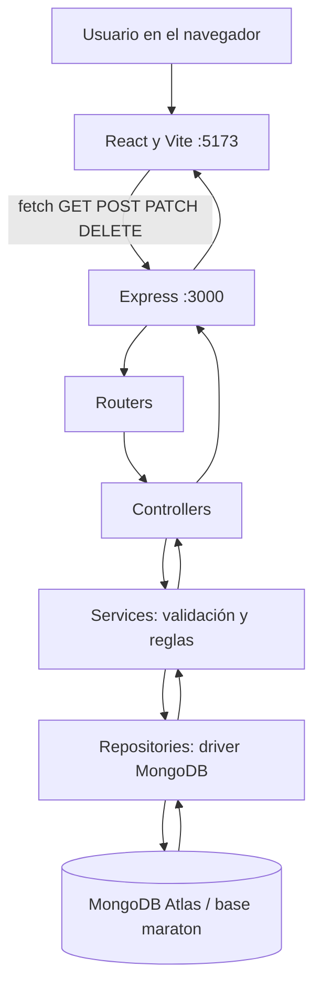
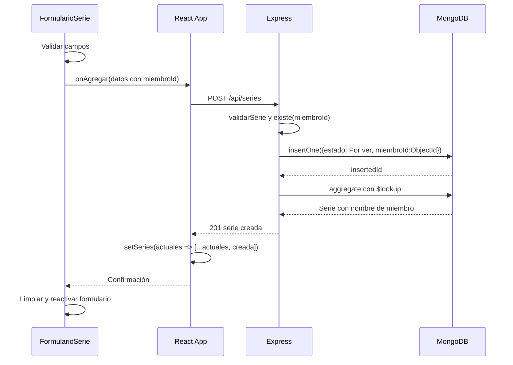
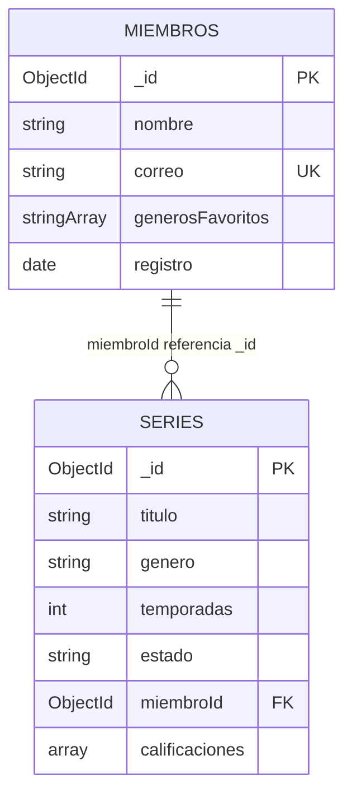

# Arquitectura del Maratón de series — etapa final

## Separación por procesos y capas

## Flujo de creación de una serie

## Modelo de datos definitivo

**Precaución:** el laboratorio inicial de `01-series.mongodb.js` utiliza IDs numéricos y miembro en texto. La migración al modelo del API se realiza en `03-preparar-modelo-api.mongodb.js`. Esta implementación no usa Mongoose: sigue el **driver oficial `mongodb`** solicitado por el docente.
